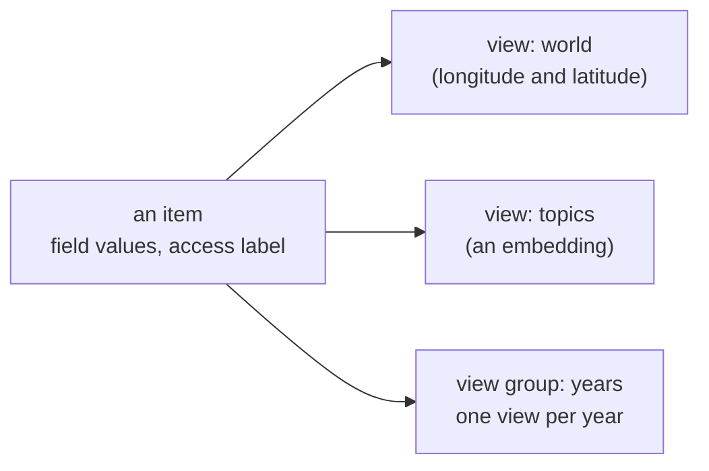

# Data model

A Mosaica database holds items. Each item has a set of field values and an access label, and a position in one or more views. This chapter describes each of those, what you choose when you declare them, and what can change once the database is running. Annotation layers, which add clusters and regions over the items, have their own [chapter](annotations.md).



*One item, with one set of values, placed in several views.*

## Items

An item is one record: a place, a paper, a specimen, a log event. Every item has:

- a value, or no value, for each field the database declares;
- an access label, which decides who may see it ([access control](access-control.md));
- a position in each view it belongs to.

An item can be named in two ways.

- **Its `mosaica_id`.** Mosaica gives every item a `mosaica_id`, a 64-bit number, and every response that returns an item includes it. It stays the same for the item's whole life in a database, through edits, restarts and compactions. Building the database again from files gives every item a new one.
- **A unique field of your own.** A field declared `unique`, such as a DOI, an accession number or a GeoNames id, names the item that holds each value. Inserts, edits, deletions and annotation memberships can all name items this way, so your own ids keep working across rebuilds. See [unique fields](#unique-fields).

A database with no unique field treats each row of a view's points as a new item. Declare one if you will ever update, delete or annotate items by your own ids.

## Views

A view lays the items out on a map. Each view has a name, and gives each of its items an x and a y.

- **A plain view** takes any two coordinates, such as a UMAP or t-SNE projection of embeddings, and draws them as they are.
- **A projected view** takes longitude and latitude in degrees, and the server projects them. You always send longitude and latitude, at a build and on every later insert.

The projections are:

| Projection | Reaches the poles | What it distorts |
|---|---|---|
| `web_mercator` | No: it stops at about 85° north and south | Area, more and more away from the equator. Shapes are kept. Standard web map tiles use it, so it lines up with a basemap |
| `equirectangular` (also `plate_carree`) | Yes | Shape, away from the equator. Longitude and latitude are scaled as they are |
| `gall_isographic` | Yes | The same transform as `equirectangular`, true to scale at 45° north and south, which gives a less stretched world |

### The frame

Each view stores its positions on a fixed grid, called its frame or extent. You declare it as `auto`, which fits the frame to the data at the build with a small margin, or as an explicit range of coordinates.

A point outside the frame is stored on the frame's edge, and the build's report or the insert's answer counts it:

- *clamped*: outside the declared frame;
- *clipped*: outside the projection itself, such as beyond `web_mercator`'s cut-off near the poles.

A build refuses a frame that more than half of the points fall outside. A coordinate that is not a finite number is always refused, and so, under a projection, is a longitude or latitude outside its range.

The frame cannot change once the view exists, so a view declared at a running server needs an explicit one.

### Who may see a view

A view can carry its own access label. A viewer must satisfy both the view's label and an item's own label to see that item through the view. Use it to keep a whole layout, such as an internal embedding, to some viewers.

### Declaring a view at a running server

A plain view can be declared at a running server. It starts empty and takes items as they are inserted into it. Declaring it again with the same settings changes nothing, and declaring it with different settings is refused. Not built yet: dropping a plain view. A view in a [view group](#view-groups) can be dropped.

## One item in several views

An item can belong to several views, such as a world map and an embedding of the same places. It has one identity, one access label and one set of values across all of them. Only its position differs. A viewer who switches from one view to another keeps their filters.

At a build, a row of a second view's points that carries a unique value an earlier view gave names that item, and places it in the second view. At a running server, an insert into a view that names an existing item, by its `mosaica_id` or a unique value, and carries a position, adds the item to that view. The item stays in its other views. It appears in the new one at the next flush.

## View groups

A view group is a family of views that share their settings and differ by a key, such as one view per year or per region. Each view is named `<group>:<key>`, as in `years:2024`.

- **Created and dropped while running.** A group's views can be created and dropped at a running server, so a new year or a new batch gets its own layout without a rebuild.
- **Per-view facts.** A group can declare facts each of its views carries, such as a year or a date range.
- **Shared membership.** Two groups can share one set of views. A yearly map and a yearly embedding can use the same keys and facts rather than declaring them twice.
- **Fields that vary by view.** A field can hold a different value for each view of a group, such as a score recomputed every year. Reading it under a view of the group gives that view's value. Reading it anywhere else needs the view named, since the item holds no single value for it.

A group's view cannot be changed once it is created. To correct one, drop it and create it again; the key can be reused, and the new view starts empty.

Dropping a view deletes every item that is in no other view, as a deletion would. The answer to the drop says how many. Items that are also in another view keep everything they hold.

## Fields

Each column you declare becomes a field. A field has a type:

| Kind | Types | Filtered by |
|---|---|---|
| Number | integers of 8 to 64 bits, signed or unsigned; 32- or 64-bit floats | an exact value, a set of values, or a range |
| True or false | `bool` | the same as numbers |
| Date and time | `timestamp_us`, microseconds since 1970 | the same as numbers |
| Category | one value from a [vocabulary](#vocabularies) | a value, or a set of values; its values can be listed and suggested as a viewer types |
| Keyword | a short string matched exactly, such as an identifier or a hostname | an exact value, a set, a prefix, or a substring |
| Text | prose in any script | the words it contains |

For each field you also make two choices, which are independent.

- **`render`**: the value is stored beside every point and sent with every point drawn, so the map can colour or size points by it. It makes every point larger, so render only what the map needs. Keywords and text cannot be rendered.
- **`index`**: the field gets an index, so it can be filtered, searched and counted. An index costs disc space and build time.

A field with neither is stored compactly and shown when someone opens the item or reads it in bulk. That is the cheapest choice. A category whose values are visible per viewer (a `derived` vocabulary, below) is always indexed, because the server needs the index to decide which values each viewer may see.

A field's type and choices are fixed once it is declared. The one exception is `unique`, described below. To change the others, rebuild from files.

### Values that are missing

An item can hold no value for a field. A missing number arrives as null, never as zero, so a range that includes zero does not match items with no value.

- **At a build** every declared column must be in the source file. A null is how a row says the item has no value.
- **On an insert** any field may be left out. For an existing item, a field left out keeps its value and a null clears it. For a new item, both leave it with no value.

### Declaring a field at a running server

A new field can be declared at a running server. Every item starts with no value in it, and inserts can fill it from then on. Declaring it again with the same settings changes nothing, and with different settings is refused. Not built yet: declaring a rendered field at a running server. Declare it at a build.

These names are used by Mosaica itself and are refused as field names: `mosaica_id`, `residual`, `x`, `y`, `access`, `node_id`, `record`, `all_of`, `any_of`, `none_of`, `region`, `member_of` and `highlighted`.

## Unique fields

A field declared `unique` holds each value on at most one item. Use it for an identifier your data already carries.

```toml
[[attribute]]
name   = "doi"
type   = "keyword"
unique = true
```

- **Types.** Keywords, integers of any width and timestamps can be unique. Floats, booleans, categories, text and fields that vary by view cannot.
- **Missing values.** Any number of items can have no value.
- **Deleted and suppressed items.** A deleted item gives up its value at once, so a new item can take it. A suppressed item keeps its value, because lifting the suppression brings the item back.
- **Naming items.** A row carrying a unique value names the item holding it. An insert that names an existing item edits it. A row inserted into a view that names no item creates a new one. A row whose values name two different items is refused.
- **Keyword values** are compared by a 128-bit hash of their bytes. Two different keywords would collide only at around 2^64 distinct values.

### Refused rows

A build leaves out a row that names two items, or that names or sets something an earlier row of its file already did. It keeps the first of two such rows, goes on with the rest, and prints a count for each file and reason with up to ten examples. It writes the same list to `reports/refused.json` in the bundle. `mosaica build --strict` stops at the first refused row instead.

An insert at a running server works the same way: the answer lists each refused row, and the batch's other rows apply. A strict insert is refused whole if any row is refused.

### Making a field unique later

`unique` is the one setting you can change on an existing field, at a build or at a running server. Turning it on builds the index over every stored value. If any value is held by more than one item, it is refused, with a count and up to ten of the values, and the field stays as it was. Turning it off drops the index and keeps the values. Inserts and deletions carry on while the index is built.

## Vocabularies

A category field takes its values from a vocabulary: a named list of values, each a key with an optional title. Several fields can share one vocabulary, such as two fields that both name departments. Which items carry which value is still tracked for each field separately.

A vocabulary's settings are:

- **Width**: `u8`, `u16` or `u32`, which sets how many values it can hold (255, 65,535 or about 4.3 billion). It cannot change later.
- **Closed or open**: a closed vocabulary refuses a value it does not hold, at a build and on insert. An open one adds it.
- **Public or derived**: a public vocabulary lists every value to every viewer. A derived one lists to each viewer only the values carried by items that viewer may see. Use derived when the list of values would itself reveal something.

Each value is stored as a code. Mosaica draws codes at random, unless you pin them in the declaration, and never reuses one. A code a viewer sees therefore says nothing about how many values exist or which came first. Retired codes can be reserved so that no value takes them.

At a running server you can add values to a vocabulary and change their titles. A changed title is what clients show from then on, and every item keeps its value.

## Not built yet

- **Fields holding a list of values.** A field holds at most one value per item.
- **Titles of views, fields and vocabularies.** A declaration may give one, and it is accepted but not yet sent to clients. A category value's title is sent.
- **Declaring a rendered field at a running server.** Declare it at a build.
- **Dropping a plain view.** A view in a view group can be dropped.
