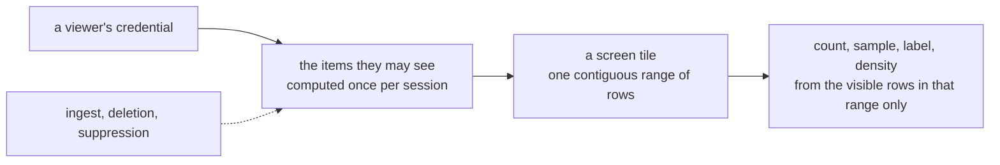

# Mosaica overview

Mosaica serves interactive, pannable, zoomable maps over a corpus of documents or records, with
access control at the level of the individual item. Each viewer gets their own map, generated on
request, from a single machine. New data can be ingested into a running service, and a deletion or
suppression applies to every request that starts after it is accepted.

Existing large-scale map servers bake a dataset into one shared view and serve the same tiles to
everyone. Mosaica computes each viewer's map from exactly the items they are permitted to see.
Every count, density, cluster and label a viewer is shown, not only the points they can retrieve,
is computed from that same set and nothing else.

This is for a corpus where different viewers are permitted to see different items: tenant
boundaries, security compartments, or a clearance recorded per record. Most systems built for that
kind of access control stop the check at retrieval: a viewer cannot open a record they lack access
to, but a count, a cluster boundary or a density gradient computed before the check ran can still
tell them it exists. A cache or a precomputed view built once for every viewer carries the same
risk, regardless of what access control is enforced on the records themselves: every viewer sees
the same aggregate.

## What you can do with it

- **A map over any records with a 2D layout**: geographic coordinates, or an embedding projection
  such as t-SNE or UMAP.
- **Several coordinate systems over one corpus**, sharing one item
  identity so a viewer can switch layout without losing their place.
- **Composable filters** over categories, numbers, dates, keywords and full text, and over drawn regions (a box, circle, ellipse or polygon).
- **Annotation layers**: clusters, hierarchies including DAGs, regions and hulls, each correct for the viewer, with access-controlled labels.
- **Highlight mode**: light the matches, dull the rest.
- **Item cards** for a selected point.
- **Bulk reads** of the items and artifacts a viewer may see, page by page as Apache Arrow
  tables, from the HTTP API, both client libraries and the command line.
- **Live ingest** into a running service, with deletion and suppression enforced on every request
  that starts after they are accepted.
- **Embeddable clients**: web components, a deck.gl layer, React bindings, and a Python notebook
  widget, or the HTTP API directly.

## How it works

An operator declares an access label on each item: an expression over terms, such as
`secret&(team_a|team_b)`. A viewer is a principal in Mosaica's identity catalogue, or an identity
from an OIDC provider. It authenticates once, with a password, an API key or an OIDC access token,
or an integrator's backend authorises a session on its behalf, and it receives a token holding the
terms granted to it. An item is visible to a viewer whose terms satisfy its label, and that
visible set is computed once per session, from a term index and a shared graph of the labels that
need more than one term.

Geometry is stored so that a screen tile at any zoom level is one contiguous range of rows, using
Morton order, a row order in which every map tile falls in a single run. A viewer's visible set is
a Roaring bitmap, a compressed set of row numbers. A count over a tile is arithmetic between that
range and the visible set, rather than a scan of the tile's contents. Sampling, density and labels
are computed the same way, from the viewer's rows and nothing else.

A deletion or suppression applies to every request that starts after it is accepted. A newly
ingested item becomes visible once it is written into a segment at the next flush, which runs on a
fixed cadence.



*A viewer's terms determine one set, reused for every tile and every kind of answer.*

Sampling happens after masking: a sparse viewer's sample is drawn from what they can see, never a
global sample with the hidden points removed. The identifier a client receives in place of an
item's own identity, its `mosaica_id`, is a keyed permutation rather than encryption, and no
defence against anyone holding the underlying bundle. The security chapter states these properties
in full, the threat model they answer to, and the disclosures accepted rather than closed.

## How it scales

Mosaica runs on one machine, with no cluster.

One streaming pass produces the whole bundle. There is no separate spatial-index build, because
the row order the geometry is written in, Morton order, is the index. A build plans its memory
layout before the pass starts, from the corpus's declared term cardinality, and peak memory follows
that plan and the number of distinct terms rather than the point count.

## What it consists of

Use it as a backend through its API and your own visualisation, or embed the components it ships
with.

Mosaica, the server, is one binary that checks a declaration, builds a bundle, serves it and
verifies it. It exposes three HTTP planes: viewer, session and control. An OpenAPI description
covers all three, so any language can read from and write to a deployment without the clients
below.

A corpus is declared in one TOML file: the files it reads, one or more coordinate systems over it,
and how a viewer's access is decided. A GeoNames declaration, shortened:

```toml
[sources]
points  = "points.parquet"
country = "vocab-country.parquet"

[defaults]
source = "points"

[[view]]
name             = "world"
projection       = "web_mercator"
extent           = { lon = [-180.0, 180.0], lat = [-85.05, 85.05] }
point_visibility = { field = "country", default = "public" }
```

`point_visibility` names the field that decides who may see each point; here, a point's `country`
value, with `public` items visible to everyone. Three commands take it from there. `mosaica check`
validates the declaration against the Parquet schemas, `mosaica build` produces the bundle in one
streaming pass, and `mosaica serve` opens it on the HTTP API.

On the client side, `<mosaica-explorer>` drops a full map into a page as a custom element,
`MosaicaLayer` adds the same data to a deck.gl scene, and in a notebook the Python client's `Map`
widget opens the same view without leaving Python.

Mosaica Client, the headless store behind these, holds the session, keeps a local copy of what has
been served, composes filters and regions, and hands off what is on screen to whatever draws it. It
does no rendering of its own. The components built on it, a full explorer, the map, filter panel,
pickers, item and artifact cards, a hierarchy browser, and more, are custom elements that work in
any framework, with a deck.gl layer and React bindings alongside them.

## What is built and what is not

| Feature | Status |
|---|---|
| The engine and the map: build, serve, ingest, live delete and suppress | Built |
| Filters and search: categories, numbers, dates, keywords, text | Built. Filtering on list-valued fields is not built yet |
| Several coordinate systems over one corpus | Built |
| Annotation layers: clusters, hierarchies, regions, hulls | Built |
| Bulk reads of items and artifacts | Built, over HTTP and in the TypeScript client, the Python client and the CLI. A read pinned to one version of the corpus is not built yet |
| Live ingest and denies | Built. A deletion or suppression hides the item from the next request; its rows are removed from disk later, at compaction, which runs on a schedule |
| Clients: web components, a deck.gl layer, React bindings, a Python notebook widget | Built. Not yet published to a package index |
| Conformance suite (the check that the guarantees hold) | Built. It checks a running server's answers against an independent reference implementation |
| Partitions and replicas | Not built |

## Where to go next

- Evaluating the approach: the [data model](data-model.md), [queries](queries.md),
  [write path](write-path.md) and [access control](access-control.md) chapters.
- Operating a deployment: [the operating guide](../guides/operating.md).
- Building against the client, or against the wire directly: the [clients](clients.md) chapter,
  the [TypeScript client reference](../reference/typescript.md) and the
  [wire framing](../openapi/README.md) page.
- Checking the security argument: the [security](security.md) chapter.
