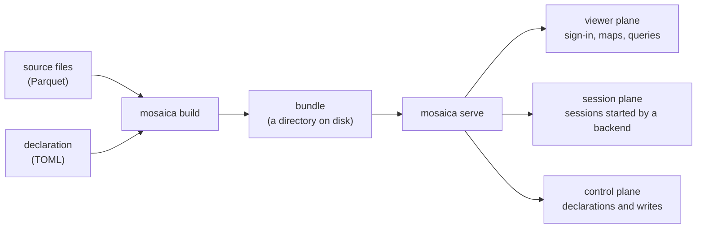

# How Mosaica works

Mosaica stores a set of items, each with a position on one or more maps, and answers questions about what a map should show. A typical question names a view, a zoom level and the part of the map on screen. The answer gives, for each map tile in that area, how many items are there, a sample of them to draw, and the annotations that label them. The design aims for every answer to read a small, contiguous part of the data, however large the whole is. This page describes the parts that make that work, and links to the chapter that covers each in full.

## From files to a running server

*The path from source files to a server answering on its three HTTP planes.*

A declaration is a TOML file that describes the data: the files to read, the views to lay the items out in, and what to do with each column. `mosaica check` reads it against the files' schemas and reports what is wrong before anything is built. `mosaica build` reads every row in one streaming pass and writes a bundle, the directory the server works from. `mosaica serve` opens the bundle and answers HTTP requests.

The server listens on three planes, each on its own address. The viewer plane is where viewers sign in and ask for maps, records and counts. The session plane lets a trusted backend start a session on behalf of one of its users. The control plane takes declarations and writes, and is usually kept to a private address or a Unix socket.

A build and a running server accept the same declarations. Anything a build can be told, such as a new view, a new field or an annotation layer, can also be sent to the control plane of a running server, and it survives a restart. The Python client uses both routes: its first `commit()` writes a declaration and runs a build, and later commits send their changes to the running server.

## Items, views and fields

An item is one record, such as a place, a paper or a specimen. A view is one layout of the items, giving each an x and a y. A view can be geographic, with a map projection such as Web Mercator, or a plain plane such as the output of UMAP. One set of items can have several views, and an item keeps its identity across them, so a viewer can switch from one layout to another and keep their selection. A view group is a family of views that share their settings and differ by a key, such as one view per year.

Each column becomes a field, of one of five families: number, datetime, category, keyword or text. A declaration makes two choices for each field. A rendered field travels with every point drawn, so the map can colour or size points by it. An indexed field can be filtered, searched and counted. A field with neither is stored and shown when someone opens the item, and costs least.

Annotation layers add structure on top of the points: clusters, hierarchies of topics, regions and hulls. Each annotation is an artifact, with its own title and its own counts.

The [data model](data-model.md) and [annotations](annotations.md) chapters cover these in full.

## How a map is answered

The build writes each view's items in Morton order. Morton order interleaves the bits of x and y, so points that are close on the map are close on disc. Its useful property here is that every map tile, at every zoom level, holds one contiguous run of rows. "What is in this tile?" becomes "which rows lie between these two numbers?"

Each indexed field has an index that gives the set of items matching a test, held as a Roaring bitmap, a compressed set of row numbers. A filter combines these sets. A count of the filtered items in a tile is then the size of the intersection between the filter's set and the tile's row range. The count is exact, and it reads no rows.

A map cannot draw every point at a wide zoom. Each tile returns a sample of the matching items in it. Dense tiles get more points than sparse ones, every tile with a matching item gets at least a few, and no tile gets more than a set cap. A point drawn at one zoom is still drawn when the viewer zooms in, so points do not flicker in and out. Beneath the points, a response can carry exact counts for finer cells, which a client can draw as shading to show density where individual points would not. Responses stream as Apache Arrow frames, tile by tile, so a client can start drawing before the whole answer has arrived.

The [queries](queries.md) and [serving](serving.md) chapters cover requests, filters, sampling, caching and how the server sheds load.

## Changes while it serves

New items, edits, deletions and suppressions are sent to the control plane. Every write is recorded in a write-ahead log before it is acknowledged, and the log is replayed if the server restarts.

New items and edits wait in a buffer until the next flush, which writes them out as a new segment and makes them visible. A flush runs every 90 seconds by default, or sooner once 40,000 rows are waiting. A write can ask to be answered only when it is visible.

A deletion or a suppression applies to every request that starts after the server accepts it. A suppression hides an item and can be lifted later. A deletion is permanent. The rows of a deleted item stay on disc, hidden, until a compaction rewrites the segments without them.

The [write path](write-path.md) chapter covers ingest, flushes, merges, compaction and recovery.

## A map for each viewer

Any item can carry an access label, an expression over terms such as `secret&(team_a|team_b)`. A viewer signs in with a password, an API key or a token from an OpenID Connect provider, or a backend starts a session for them, and the viewer's session holds a set of terms. The items whose labels those terms satisfy make up the viewer's visible set. Mosaica computes it once, when the session starts, as a Roaring bitmap.

Every answer the viewer then gets is computed inside that set. A tile's count is the intersection of three things: the tile's rows, the filter's set and the visible set. Samples are drawn from the visible items, so a viewer who can see few items still gets a full sample of those. Cluster counts and annotation titles are computed or withheld in the same way. A filter can only narrow what a viewer sees. Clients identify items by a `mosaica_id`, a keyed permutation of the internal id, so that ids cannot be used to count hidden items.

A deployment that needs none of this declares no labels. Every item then carries the default label, `public`, which every viewer holds.

The [access control](access-control.md) chapter covers labels, identities and sessions, and the [security](security.md) chapter sets out the threat model and what a viewer can and cannot learn.

## One machine

Mosaica runs as one process on one machine, with no cluster. The build streams its input, so the source files need not fit in memory. Before it starts, the build plans its memory from what the declaration says about each field. Its peak memory then depends on the number of distinct values, such as categories and access terms, more than on the number of points. A running server keeps its caches within sizes set in its configuration, and runs under a memory cap set by systemd or Docker. `mosaica build --memory-budget` sets the build's own limit. The [operating guide](../guides/operating.md) explains how to size each of them.

## The clients

The HTTP API is described by an OpenAPI document, so any language can read from and write to a server. Three clients are built on it.

- The Python client makes a database from data frames, draws it as a map in a Jupyter notebook, and returns query results as Arrow tables.
- The TypeScript client keeps a viewer's session and a local copy of what has been served, and composes filters. It draws nothing itself. Web components built on it provide a full explorer, a map, filter panels, pickers and cards, which work in any framework, with a deck.gl layer and React bindings beside them.
- The `mosaica` command line builds and serves, manages users and keys, and reads records and counts.

The [capabilities](../reference/capabilities.md) table lists which call does what on each surface. The [clients](clients.md) chapter explains how the TypeScript client keeps its copy of the map up to date.

## What is built

| Feature | Status |
|---|---|
| Build, serve, live ingest, deletion and suppression | Built |
| Filters and search over numbers, dates, categories, keywords and text | Built. A field holds one value per item; fields holding a list of values are not built yet |
| Several views over one set of items, and view groups | Built |
| Annotation layers: clusters, hierarchies, regions and hulls | Built |
| Reading records and annotations in bulk | Built, on all four surfaces. A read pinned to one version of the data is not built yet |
| Deleting and drawing a map from the command line | Not built yet |
| Python and TypeScript packages | Built. Not yet published to PyPI or npm |
| A conformance suite that checks a running server's answers against an independent reference implementation | Built |
| Running across several machines, and replicas | Not built |

## Where to go next

- To see how items, views and fields are declared: [data model](data-model.md).
- To see how a request is answered: [queries](queries.md), then [serving](serving.md).
- To see how changes reach a running server: [write path](write-path.md).
- To run a deployment: the [operating guide](../guides/operating.md).
- To build a client, or to read the wire format directly: [clients](clients.md) and [wire framing](../openapi/README.md).
- To check the access-control argument: [access control](access-control.md), then [security](security.md).
